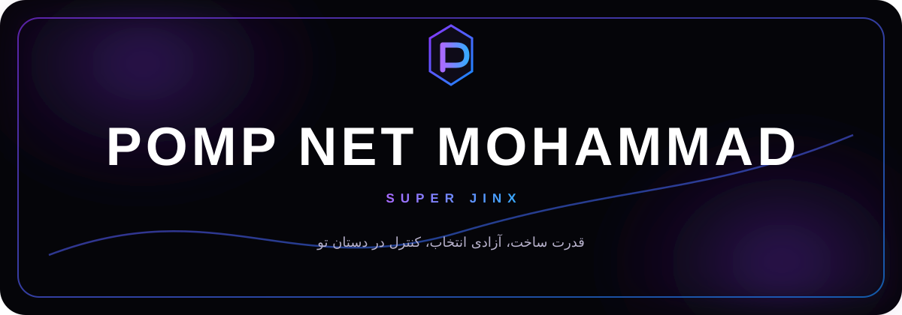

 

### قدرت ساخت، آزادی انتخاب، کنترل در دستان تو

**پنل اختصاصی مدیریت Marzban با هویت POMP NET و رابط کاربری SUPER JINX**

[گروه پمپ‌نت](https://t.me/PompNett) • [کانال رسمی](https://t.me/pompnet) • [کانال پروکسی](https://t.me/Myporoxy18) • [GitHub سازنده](https://github.com/uxurx7rh7e7xr73uue73e8)

---

## ✦ درباره پروژه

**POMP NET MOHAMMAD — SUPER JINX** یک پروژه سفارشی‌سازی‌شده بر پایه Marzban است. هدف، حفظ هسته و منطق اصلی مدیریت کاربران و سرویس‌ها، در کنار ارائه هویت بصری اختصاصی پمپ‌نت است.

> این مخزن در مرحله تکمیل و اعتبارسنجی است؛ وجود فایل در GitHub به معنی تست‌شدن یا آماده‌بودن آن برای استفاده عملیاتی نیست.

## ◈ هویت بصری

| بخش | مشخصات |
|---|---|
| نام پروژه | POMP NET MOHAMMAD — SUPER JINX |
| زبان رابط | فارسی و راست‌چین (RTL) |
| پس‌زمینه | مشکی عمیق `#050509` |
| رنگ اصلی | بنفش نئونی `#8B35FF` |
| رنگ مکمل | آبی نئونی `#168CFF` |
| پیام صفحه ورود | کدنویسی و توسعه توسط تیم پمپ نت |
| عنوان اشتراک | POMP NET MOHAMMAD |
| پشتیبانی | [@PompNett](https://t.me/PompNett) |

## ⚡ امکانات و اجزای موجود در سورس

- هسته مدیریتی مبتنی بر Marzban
- فایل‌های رابط و پوسته اختصاصی Jinx
- صفحه اشتراک سفارشی
- تنظیمات Nginx و مسیرهای WebSocket
- فایل‌های پیکربندی Xray و ابزار قفل/ساخت تنظیمات
- ابزارهای مدیریتی و بررسی سلامت
- مدیریت امن حساب مدیر در نصب تازه و ری‌استارت
- صفحه حمایت و تنظیمات مربوط به آن

**توجه:** این فهرست، اجزای موجود در مخزن را معرفی می‌کند و تأیید عملکرد عملیاتی تک‌تک آن‌ها نیست.

## 🔐 امنیت حساب مدیر

در نصب تازه، ورود پیش‌فرض `admin/admin` استفاده نمی‌شود.

متغیرهای لازم برای ساخت مدیر اولیه:

| متغیر | الزام |
|---|---|
| `ADMIN_USERNAME` | حداقل ۳ نویسه |
| `ADMIN_PASSWORD` | حداقل ۱۴ نویسه و غیرقابل حدس |

- در ری‌استارت عادی، حساب و رمز مدیر موجود باید حفظ شود.
- تغییر رمز فقط با تنظیم صریح `RESET_ADMIN_PASSWORD=1` و ارائه نام کاربری و رمز جدید انجام می‌شود.
- پس از بازیابی رمز، متغیر `RESET_ADMIN_PASSWORD` را حذف کنید.
- هیچ رمز، توکن یا کلید محرمانه‌ای را داخل کد یا GitHub قرار ندهید.

## 🧭 وضعیت واقعی پروژه

| مورد | وضعیت |
|:---|:---:|
| مخزن اختصاصی POMP NET | 🟢 ایجاد شده |
| سفارشی‌سازی برند و فایل‌های منتخب | 🟡 در حال تکمیل |
| انتقال کپی کامل ۸۴ مورد مرجع | 🟡 عمداً انجام نشده؛ بخش زیادی مستندات/تصویر است |
| بررسی وابستگی‌ها و فایل‌های جانبی | 🔴 باقی‌مانده |
| بررسی نحوی Shell/Python/JSON | 🟢 موفق در GitHub Actions |
| ساخت Docker image | 🟢 موفق در GitHub Actions |
| تست ورود مدیر | ⚪ هنوز اجرا و تأیید نشده |
| تست ساخت کاربر و مدیریت اشتراک | ⚪ هنوز اجرا و تأیید نشده |
| تست اجرای واقعی Xray | ⚪ هنوز اجرا و تأیید نشده |
| تست لینک اشتراک از بیرون | ⚪ هنوز اجرا و تأیید نشده |
| تست پایداری داده با Volume | ⚪ هنوز اجرا و تأیید نشده |
| آماده انتشار عمومی | 🔴 خیر |

### 📦 وضعیت انتقال فایل‌ها

- سورس مرجع [MarzbanUpdate](https://github.com/x4gpanell/MarzbanUpdate) در زمان بررسی شامل **۸۴ فایل** بود.
- مخزن اختصاصی پیش از این به‌روزرسانی شامل **۱۷ فایل** بود.
- فایل گرافیکی اختصاصی این README نیز اضافه شده است.
- بنابراین انتقال کامل سورس مرجع هنوز انجام نشده و نباید این نسخه را کپی کامل و آماده انتشار معرفی کرد.

### 🧪 معیارهای لازم برای تأیید نسخه

قبل از اعلام آماده‌بودن پروژه، موارد زیر باید روی یک محیط آزمایشی واقعی بررسی شوند:

1. تکمیل انتقال فایل‌های موردنیاز و وابستگی‌ها، بدون حذف قابلیت‌های هسته.
2. موفقیت ساخت Docker؛ این مرحله در GitHub Actions با موفقیت انجام شده است. بالا آمدن سرویس‌ها در runtime هنوز باید جداگانه بررسی شود.
3. ورود مدیر و حفظ رمز موجود پس از ری‌استارت.
4. ساخت، ویرایش، غیرفعال‌سازی و حذف آزمایشی کاربر.
5. اجرای سالم Xray و بررسی لاگ خطاها.
6. دریافت لینک اشتراک و بررسی محتوای آن در کلاینت واقعی.
7. ری‌استارت و بازسازی سرویس با اطمینان از باقی‌ماندن دیتابیس و تنظیمات روی Volume.
8. بررسی امنیت متغیرها، مسیرهای عمومی و دسترسی‌های مدیریتی.

تست‌های نحوی و ساخت Docker در GitHub Actions با موفقیت ثبت شده‌اند (Run #1، commit `66f98dbc2e433bf34f11191fccfbd53e6fa7d077`). این موفقیت فقط صحت نحوی و ساخت image را ثابت می‌کند؛ ورود، ساخت کاربر، Xray، لینک اشتراک و ماندگاری Volume هنوز **تأییدنشده** هستند.

## 🚀 استقرار و زیرساخت

این پروژه سرویس VPN/Proxy مبتنی بر Xray است. پیش از انتخاب میزبان، سیاست استفاده ارائه‌دهنده را بررسی کنید و در صورت نیاز تأیید کتبی بگیرید. **برای دور زدن محدودیت‌های میزبان، ماهیت سرویس را پنهان نکنید.**

برای استقرار عملیاتی، محیطی انتخاب شود که میزبانی این نوع سرویس را صراحتاً مجاز بداند و امکان ذخیره‌سازی پایدار فراهم کند. مسیر داده برنامه در این نسخه:

`/var/lib/marzban`

پورت داخلی وب در پیکربندی فعلی:

`8080`

وجود این مقادیر به معنی تست موفق استقرار نیست. استقرار روی Railway در این پروژه تأیید نشده و به‌دلیل محدودیت‌های میزبانی سرویس‌های VPN/Proxy، توصیه نمی‌شود مگر اینکه مجوز صریح ارائه‌دهنده دریافت شود.

## 🧩 منابع و اعتبار

- پروژه پایه: [Marzban](https://github.com/Gozargah/Marzban)
- سورس مرجع سفارشی‌سازی: [MarzbanUpdate](https://github.com/x4gpanell/MarzbanUpdate)
- هسته ارتباطی: [Xray-core](https://github.com/XTLS/Xray-core)

این پروژه بر پایه نرم‌افزارهای بالادستی ساخته می‌شود. حقوق، مجوزها و اعلان‌های حق‌نشر هر جزء باید مطابق مجوز اصلی آن حفظ شوند. این مخزن ادعای مالکیت هسته Marzban، Xray یا کد اشخاص ثالث را ندارد.

## 💬 ارتباط با پمپ‌نت

**POMP NET MOHAMMAD — SUPER JINX**

قدرت ساخت، آزادی انتخاب، کنترل در دستان تو

